# Gantt Studio

**Projektpläne erstellen, Termine steuern und den gesamten Zeitplan verständlich teilen.** Gantt Studio ist ein deutschsprachiges, browserbasiertes Werkzeug für Gantt-Diagramme, Aufgaben, Projektphasen und Meilensteine. Es läuft direkt im Browser. Projekte werden automatisch **lokal** gespeichert.

**[Gantt Studio öffnen](https://thomasasen.github.io/gantt-studio/)** · [Schnellstart](#schnellstart-in-5-schritten) · [Exportieren](#projekt-oder-diagramm-exportieren) · [Datensicherung](#speicherung-datenschutz-und-backups)

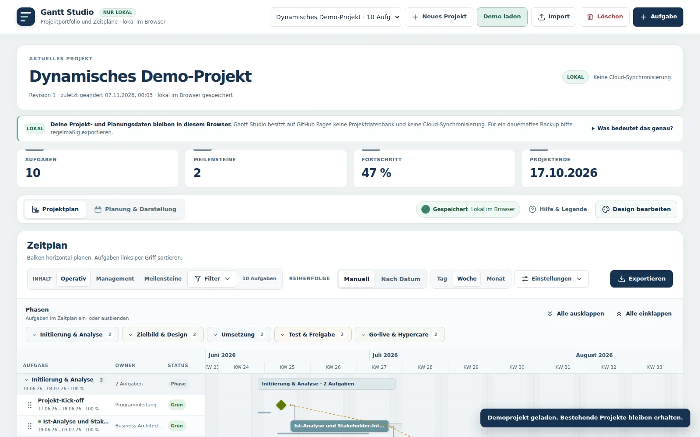

Das Wichtigste auf einen Blick: Aufgaben lassen sich direkt im Zeitplan **verschieben und verlängern**, Termine und Verantwortliche in der **Tabelle** ändern, **Phasen und Abhängigkeiten** abbilden sowie Pläne für Besprechungen als **PDF** oder vollständiges **PNG-/JPG-Bild** ausgeben. Elf Designvorlagen helfen dabei, einen lesbaren Plan für unterschiedliche Zwecke zu gestalten.

> **Wichtig zur Speicherung:** Es gibt keine Gantt-Studio-Cloud. Deine Projekte liegen im aktuellen Browserprofil. Für eine dauerhafte Sicherung und den Gerätewechsel benötigst du einen regelmäßigen **JSON-Export**.

## Schnellstart in 5 Schritten

1. **[Anwendung öffnen](https://thomasasen.github.io/gantt-studio/).** Eine Installation oder Anmeldung ist nicht nötig.
2. Oben auf **Demo laden** klicken, um die Funktionen mit einem Beispielprojekt kennenzulernen. Mit **Neues Projekt** beginnst du stattdessen einen leeren Plan.
3. Über **Aufgabe** eine neue Aufgabe anlegen: Name, Start- und Enddatum eingeben, dann **Übernehmen**. Alternativ in der Tabelle **Neue Aufgabe** wählen.
4. Im **Projektplan** einen Balken verschieben oder über **Aufgaben & Abhängigkeiten** eine Tabellenzelle bearbeiten. Die Zeitachse kann zwischen **Tag**, **Woche** und **Monat** wechseln.
5. Den Status **Gespeichert** kontrollieren und über **Exportieren → Projektdatei** eine portable Sicherung als `.gantt.json` erstellen.

Das Demoprojekt wird als **zusätzliches Projekt** importiert. Bereits angelegte Pläne werden dadurch nicht überschrieben.

## Oberfläche kennenlernen

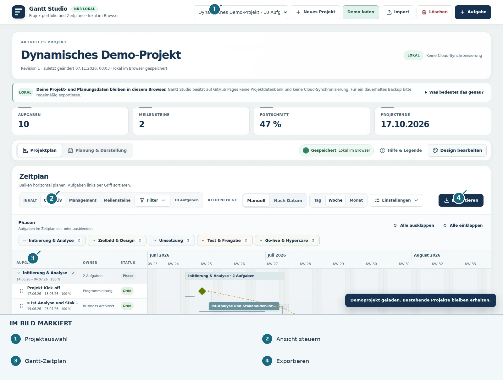

**1** Über die *Projektauswahl* wechselst du zwischen lokalen Projekten. **2** Mit *Operativ*, *Management*, *Meilensteine* und *Filter* legst du fest, was du sehen möchtest. **3** Der *Gantt-Zeitplan* zeigt Aufgaben, Phasen und Termine. **4** Über *Exportieren* sicherst du das Projekt oder gibst den Plan weiter.

Unter dem Diagramm befindet sich **Aufgaben & Abhängigkeiten**: Dort lassen sich Aufgabendaten tabellarisch bearbeiten. Mit dem zweiten Arbeitsbereich **Planung & Darstellung** steuerst du Phasen, Marker, Sondertage und Anzeigeoptionen. Der sichtbare **Speicherstatus** bestätigt, ob deine Änderungen lokal übernommen wurden.

## Projekte verwalten

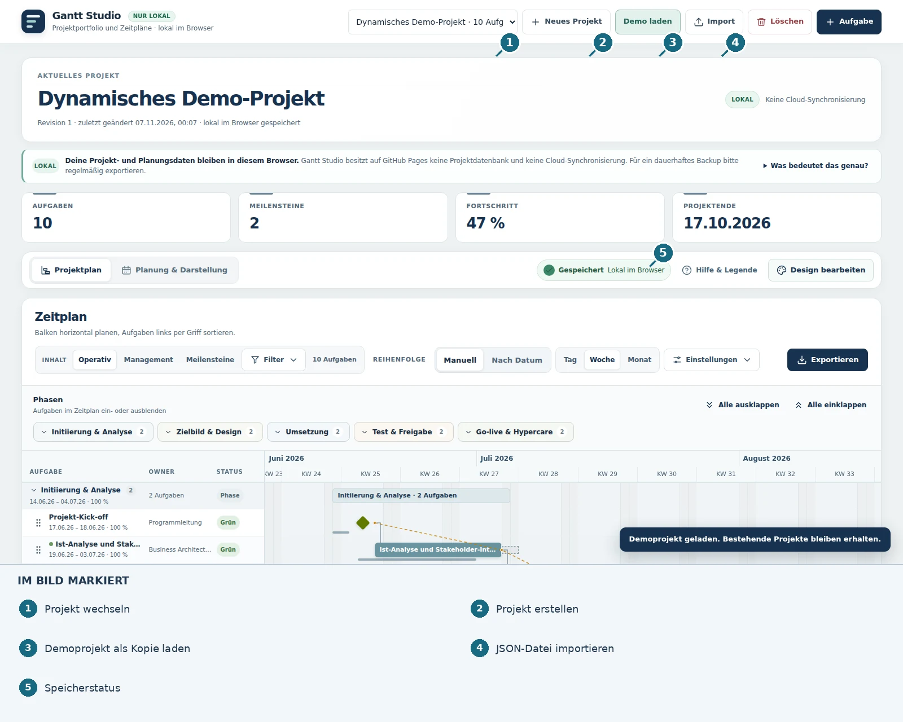

- **Neues Projekt:** einen leeren Plan anlegen; der Projektname kann im Projektkopf geändert werden.
- **Projekt auswählen:** zwischen allen im Browser gespeicherten Projekten wechseln.
- **Demo laden:** eine eigene Kopie des mitgelieferten Beispiels anlegen. Bei erneutem Laden bleibt die vorherige Kopie erhalten.
- **Import:** eine zuvor exportierte `.gantt.json`-Projektdatei einlesen. Beim Import vergibt die Anwendung neue Projekt- und Aufgaben-IDs, um vorhandene Projekte nicht zu überschreiben.
- **Löschen:** ein lokales Projekt entfernen. Diese Aktion ersetzt keine Sicherung.
- **Gespeichert / Speichert… / Nicht gespeichert:** direkt im oberen Arbeitsbereich prüfen, ob die lokale Speicherung abgeschlossen ist oder ein Fehler vorliegt.

**Arbeitsbeispiel:** Lade zunächst die Demo, benenne anschließend ein neues Projekt „Website-Relaunch“ und exportiere es nach der ersten Planungsrunde als JSON. So bleiben Beispiel und eigene Planung getrennt.

## Mit dem Gantt-Zeitplan arbeiten

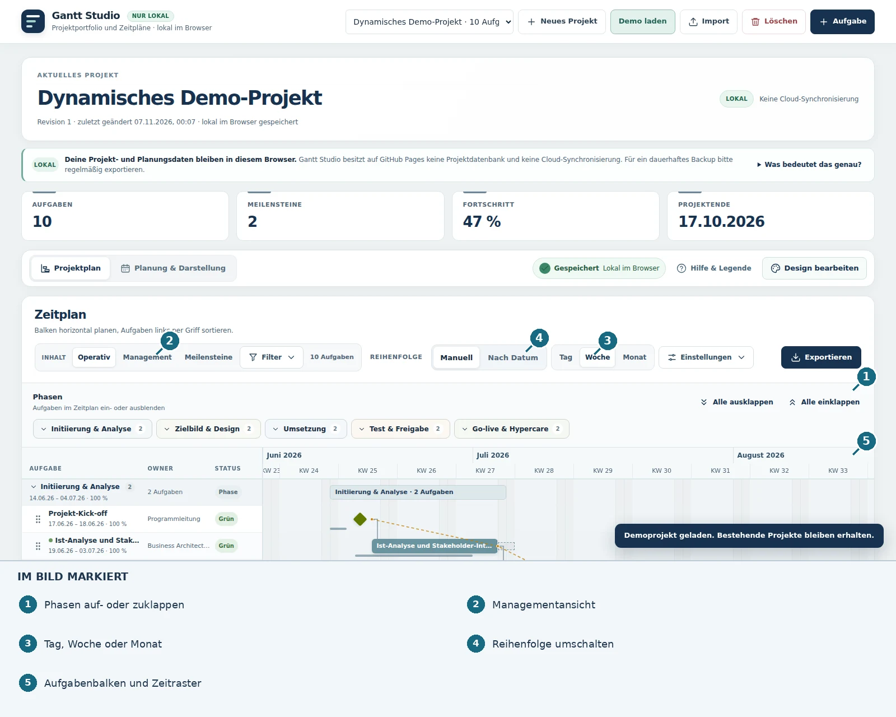

Der Zeitplan verbindet eine linke Aufgabenliste mit einer rechten Zeitachse. Aufgaben erscheinen als Balken, Meilensteine und Gates als besondere Symbole. Phasen können eigene Sammelzeilen besitzen.

**Zeitskala:** Wähle **Tag**, **Woche** oder **Monat**, um zwischen genauer Terminbearbeitung und Überblick zu wechseln. Die Zeitachse lässt sich horizontal scrollen. Über **Einstellungen** steuerst du zusätzliche Anzeigeelemente.

**Reihenfolge:** Über **Manuell** ordnest du Aufgaben mit dem Verschiebegriff innerhalb ihrer Phase. **Nach Datum** zeigt sie stattdessen chronologisch. Die Schalter in Gantt und Aufgabentabelle bleiben synchron. Eine Änderung der manuellen Reihenfolge ändert **keine** Termine, Abhängigkeiten oder Phasenzuordnungen.

### Aufgaben direkt am Balken bearbeiten

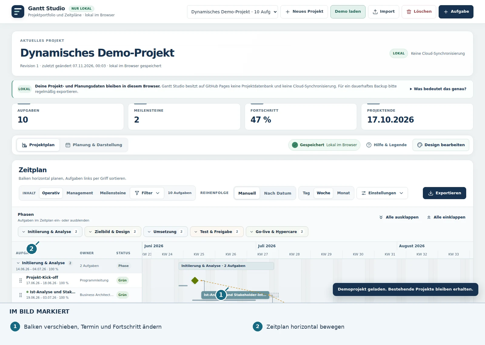

- **Verschieben:** einen Aufgabenbalken ziehen, um den Zeitraum zu ändern.
- **Dauer ändern:** den linken oder rechten Resize-Griff verwenden, um Start oder Ende anzupassen.
- **Fortschritt ändern:** den Fortschrittsgriff des Balkens bewegen.
- **Abbrechen:** Eine laufende Interaktion kann mit **Escape** abgebrochen werden. Erst eine gültig abgeschlossene Änderung wird gespeichert.

Über Aufgabeneditor und Tabelle gibt es alternative Eingabemöglichkeiten, auch ohne Maus-Drag-and-drop. Beim zeitlichen Verschieben werden die Werte auf das Datumsraster abgebildet.

## Aufgaben, Status und Abhängigkeiten

### Aufgabeneditor

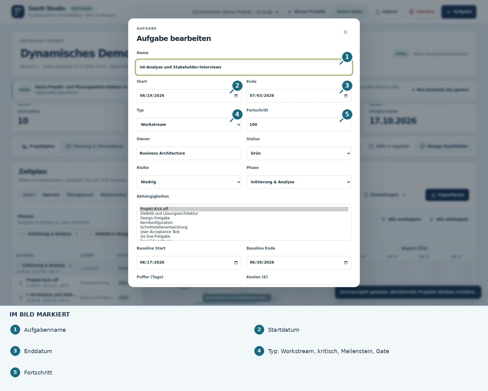

Klicke **Aufgabe** zum Anlegen oder öffne eine bestehende Aufgabe über **Bearbeiten** beziehungsweise per **Enter** auf einem fokussierten Gantt-Balken.

Im Dialog bearbeitest du Name, Start, Ende, Typ, Fortschritt, **Owner**, Ampelstatus, Risiko, Phase und Abhängigkeiten. Weitere Felder umfassen Baseline-Start und -Ende, Puffer in Tagen, Kosten, Link und Notizen. Über **Übernehmen** speicherst du die Änderungen.

Der Aufgabentyp bestimmt die Darstellung:

| Typ | Verwendung |
| --- | --- |
| **Workstream** | Normale Aufgabe oder Arbeitspaket über mehrere Tage |
| **Kritisch markiert** | Manuell hervorgehobenes Arbeitspaket |
| **Meilenstein** | Wesentliches Ergebnis oder Ereignis |
| **Gate** | Entscheidung oder Freigabe |

**Kritisch markiert ist keine Critical-Path-Berechnung.** Gantt Studio führt derzeit keine automatische CPM-/Critical-Path-Analyse durch. Die Kennzeichnung wird von dir gesetzt.

### Tabellenansicht und Inline-Bearbeitung

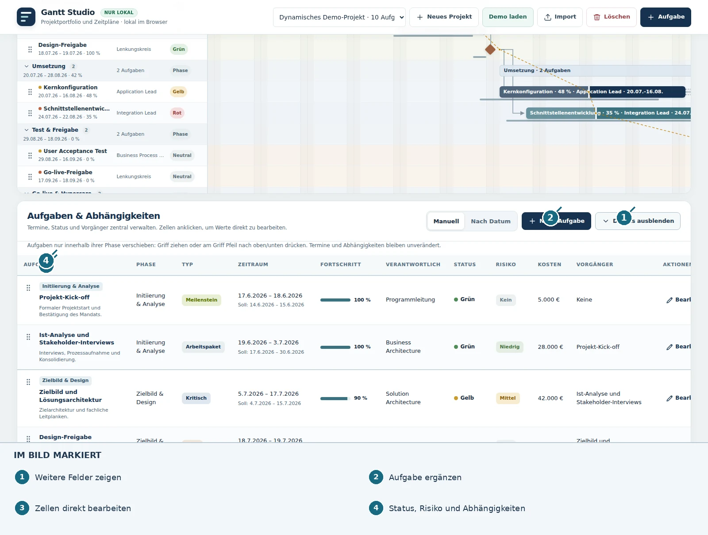

Unter **Aufgaben & Abhängigkeiten** stehen Name, Zeitraum, Fortschritt, Verantwortliche und Status. **Details anzeigen** ergänzt Phase, Typ, Risiko, Kosten und Vorgänger. Du kannst Zellen direkt anklicken oder mit **Enter** beziehungsweise **F2** bearbeiten. **Escape** verwirft eine laufende Inline-Änderung.

Die Tabelle und das Gantt-Diagramm bearbeiten denselben Projektstand. Über den Verschiebegriff kannst du Aufgaben innerhalb ihrer Phase auch in der Tabelle manuell sortieren. Mit den Pfeiltasten am Griff steht eine Tastaturalternative zur Verfügung.

### Vorgänger, Baseline und Puffer

Im Aufgabeneditor wählst du unter **Abhängigkeiten** die Vorgänger einer Aufgabe. Der Zeitplan kann die Beziehungen mit Verbindungspfeilen darstellen. **Zyklische Abhängigkeiten** werden beim Bearbeiten zurückgewiesen.

Die **Baseline** macht einen ursprünglich hinterlegten Terminplan als zusätzliche Linie sichtbar. **Puffer (Tage)** bildet eine Reserve nach der Aufgabe ab. Status und Risikostufe ergänzen die Terminansicht; sie sind kein Ersatz für eine automatische Termin- oder Risikoanalyse.

## Projektphasen und Planung

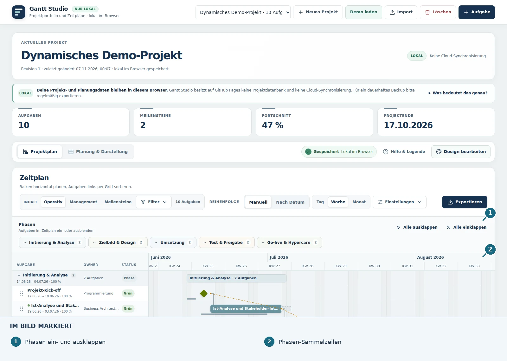

Mit Phasen strukturierst du umfangreiche Pläne, beispielsweise in „Analyse“, „Umsetzung“, „Test“ und „Go-live“. Die Leiste über dem Zeitplan zeigt Phasen und Aufgabenanzahl. Einzelne Phasen können ein- oder ausgeklappt werden; es gibt auch Aktionen für alle Phasen. Der Zustand wird pro Projekt im Browser gemerkt.

Phasen selbst legst du unter **Planung & Darstellung → Phasen** an, bearbeitest oder löschst sie. Die Zuordnung einer Aufgabe erfolgt im Aufgabeneditor oder in der detaillierten Aufgabentabelle.

### Management- und Meilensteinansicht

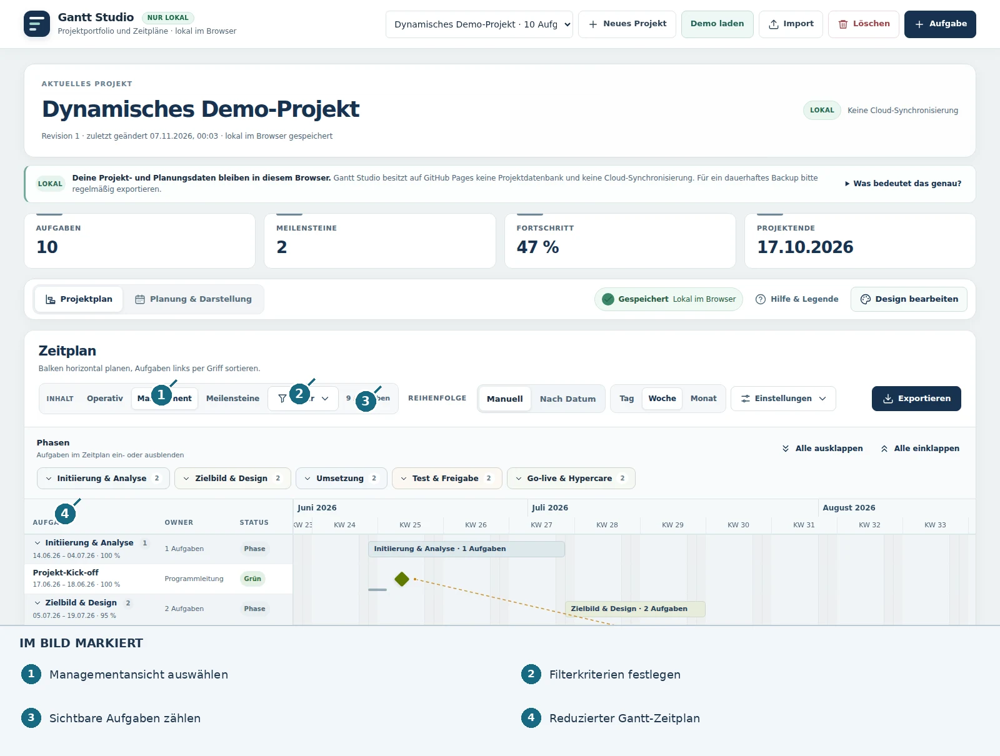

- **Operativ:** der gewöhnliche Arbeitsüberblick.
- **Management:** die gemäß den aktivierten **Filter**-Kriterien relevanten Aufgaben. Dazu können kritisch markierte Aufgaben, Meilensteine, Gates, hohe Risiken, rote Statuswerte und überfällige offene Aufgaben zählen.
- **Meilensteine:** Konzentration auf wichtige Ereignisse und Entscheidungen.

Der Aufgabenzähler zeigt, wie viele Aufgaben gerade dargestellt werden. Wenn eine Aufgabe scheinbar fehlt, prüfe zunächst **Ansichtsmodus**, **Filter** und **eingeklappte Phasen**.

### Planung & Darstellung

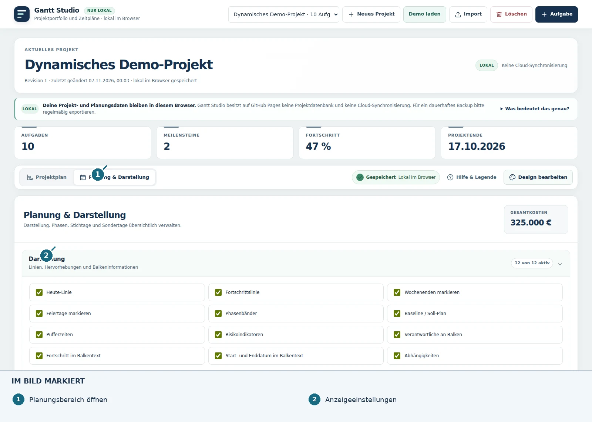

Im Arbeitsbereich **Planung & Darstellung** findest du vier Gruppen:

1. **Darstellung:** heute-bezogene Linien, Fortschritt, Vorgängerpfeile, Wochenenden, Feiertage, Phasenbänder, Baseline, Puffer und zusätzliche Beschriftungen anzeigen oder ausblenden.
2. **Phasen:** Projektabschnitte verwalten.
3. **Stichtage und Gates:** zusätzliche vertikale Terminmarker anlegen. Ein *Gate als Aufgabe* ist etwas anderes als eine *Stichtagslinie*.
4. **Feiertage und Sondertage:** besondere Kalendertage ergänzen oder deutsche Feiertage über **DE importieren** abrufen.

### Dynamische Zieldatumslinie

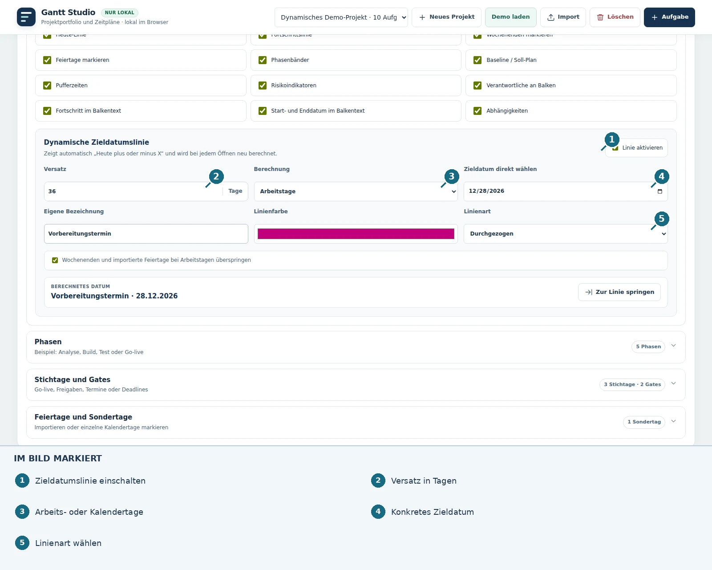

Aktiviere die **Dynamische Zieldatumslinie**, lege einen positiven oder negativen Versatz fest und wähle **Arbeitstage** oder **Kalendertage**. Du kannst stattdessen direkt ein Zieldatum auswählen. Bezeichnung, Farbe und Linienart sind anpassbar.

Bei der Berechnung nach Arbeitstagen können Wochenenden und importierte Feiertage ausgelassen werden. Mit **Zur Linie springen** navigierst du zum berechneten Termin.

## Ansichten und Design anpassen

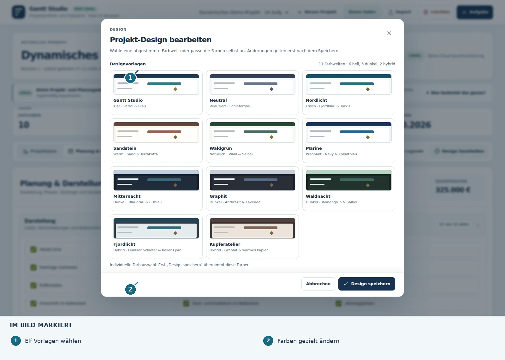

Unter **Design bearbeiten** stehen elf Farbwelten zur Verfügung: sechs helle (**Gantt Studio, Neutral, Nordlicht, Sandstein, Waldgrün, Marine**), drei dunkle (**Mitternacht, Graphit, Waldnacht**) und zwei hybride (**Fjordlicht, Kupferatelier**).

Die Hybrid-Varianten kombinieren dunklere Steuerungsbereiche mit einer hellen Arbeitsfläche für Diagramm und Tabelle. Zusätzlich kannst du einzelne Projektfarben ändern. Die Vorschau verändert den gespeicherten Plan **noch nicht**; erst **Design speichern** übernimmt sie. Das Design bleibt Teil der JSON-Projektdatei. Die Druckausgabe verwendet unabhängig davon einen lesbaren hellen Papierhintergrund.

## Projekt oder Diagramm exportieren

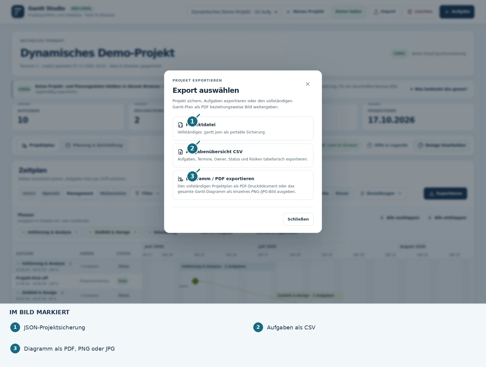

Klicke im Projektplan auf **Exportieren**. Der Dialog bietet drei Wege:

| Format | Ergebnis | Geeignet für |
| --- | --- | --- |
| **JSON** | Vollständige `.gantt.json`-Projektdatei | Sicherung, Archiv und Import in einem anderen Browser |
| **CSV** | Tabellenexport der Aufgabeninformationen | Auswertung in Tabellenprogrammen |
| **PDF** | Mehrseitiger Projektplan über den Browserdruckdialog | Druck, Besprechungen, abgestimmte Berichte |
| **PNG** | **Ein einziges Bild** des vollständigen Gantt-Diagramms | Präsentationen, Dokumente, verlustfreie Grafik |
| **JPG** | **Ein einziges Bild** des vollständigen Gantt-Diagramms | Kompakte Bilddateien zum Weitergeben |

### PDF für druckfertige Projektpläne

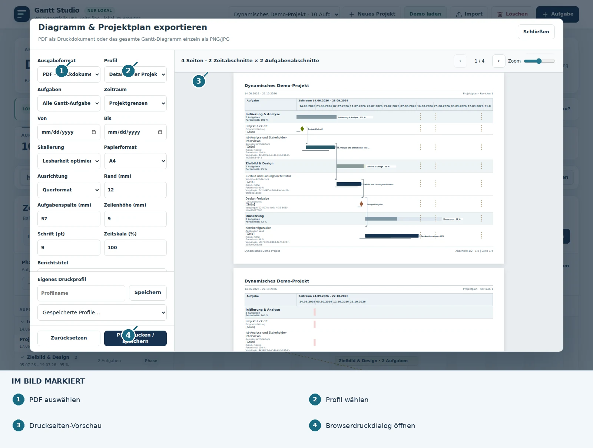

Wähle **Diagramm / PDF exportieren** und anschließend **PDF**. Im Dialog lassen sich unter anderem Profile, Aufgaben- und Zeitraumauswahl sowie Papierformat (A4/A3), Ausrichtung und Skalierung einstellen. Die Vorschau zeigt die aufgeteilten Druckseiten.

Mit **PDF drucken / speichern** öffnest du den **Browserdruckdialog**. Wähle dort die PDF-Ausgabe deines Browsers, um die Datei zu speichern. Gantt Studio liefert hier keinen separaten, direkt heruntergeladenen PDF-Blob.

### PNG oder JPG als vollständiges Diagrammbild

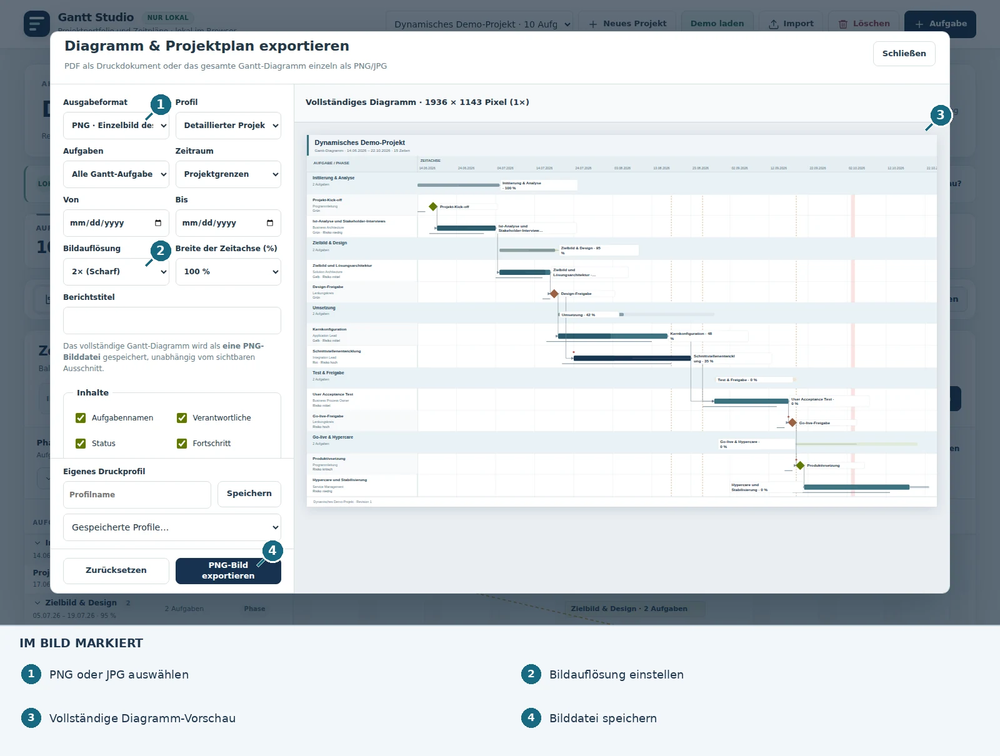

Im selben Dialog wählst du **PNG** oder **JPG**, die Bildauflösung **1×, 2× oder 3×** und bei JPG die Qualitätsstufe. Die Aktion heißt passend zum Format **PNG-Bild exportieren** oder **JPG-Bild exportieren**.

**Wichtig:** Hier wird nicht einfach der sichtbare Browserausschnitt fotografiert. Die Anwendung erzeugt ein **zusammenhängendes Diagrammbild** aus dem ausgewählten Projekt- und Zeitbereich, einschließlich der entsprechenden Aufgaben, Phasen und Beschriftungen. Die sichtbaren Balkenbeschriftungen richten sich nach der gespeicherten Labelkonfiguration. Der Bildexport benötigt ausreichend verfügbaren Browser-Speicher; bei zu großen Ausmaßen erscheint eine Fehlermeldung, statt stillschweigend einen Ausschnitt zu speichern.

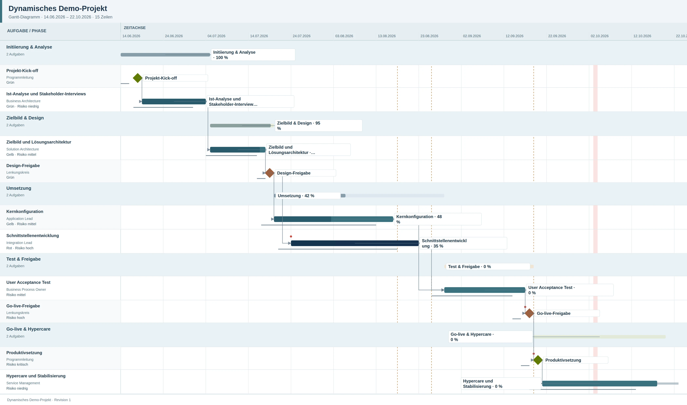

*Beispiel eines tatsächlich aus der Anwendung exportierten PNG-Diagramms. Es stammt aus dem Demoprojekt und wurde für die Dokumentation als WebP optimiert.*

## Speicherung, Datenschutz und Backups

**Wo gespeichert wird:** Projekt- und Planungsdaten liegen in **IndexedDB** des verwendeten Browserprofils. Einige lokale Ansichts- und Druckeinstellungen sowie die aktive Projekt-ID werden zusätzlich in **localStorage** abgelegt. Die Anwendung speichert Änderungen automatisch; den aktuellen Zustand zeigt der Speicherstatus.

**Was nicht passiert:** Gantt Studio betreibt auf GitHub Pages keine eigene Cloud-Projektdatenbank. Es synchronisiert Projekte nicht automatisch zwischen Geräten, Browserprofilen oder Computern. Projektinhalte werden durch die Anwendung nicht an GitHub übertragen.

**Was du selbst sichern musst:** Exportiere wichtige Projekte regelmäßig über **Exportieren → Projektdatei** und bewahre die `.gantt.json`-Dateien an einem sicheren Ort auf. Ein JSON-Backup enthält den vollständigen Projektstand, während CSV nur eine tabellarische Aufgabenübersicht und PNG/JPG/PDF nur eine Darstellung liefern.

Beim Löschen von Website-Daten, beim Wechsel des Browserprofils oder bei der Nutzung eines anderen Geräts können lokale Projekte fehlen. Der optionale **DE-Feiertagsimport** fragt über `date.nager.at` Feiertage ab; dabei werden Jahr und Länderangaben, nicht der Projektinhalt, übertragen. Webhosting und externe Dienste können technisch übliche Verbindungsdaten verarbeiten.

## Häufige Fragen

**Muss ich etwas installieren oder ein Konto anlegen?** Nein. Die Anwendung läuft im aktuellen Browser und benötigt kein eigenes Gantt-Studio-Konto.

**Kann ich ein Projekt auf einen anderen Computer mitnehmen?** Ja. Auf dem ersten Gerät **Exportieren → Projektdatei** wählen und auf dem anderen Gerät über **Import** einlesen. Die Browserdaten synchronisieren sich nicht selbst.

**Warum sehe ich eine Aufgabe nicht?** Prüfe zunächst **Operativ / Management / Meilensteine**, die Filter, den gewählten Zeitraum und die ein- oder ausgeklappten Phasen.

**Wie lege ich eine Abhängigkeit an?** Öffne die Aufgabe und wähle unter **Abhängigkeiten** den oder die Vorgänger. Zyklen sind nicht erlaubt.

**Was bedeutet „kritisch“?** Es ist eine manuelle Markierung. Eine automatische Critical-Path-Berechnung gehört aktuell nicht zum Funktionsumfang.

**Wie erhalte ich ein komplettes Diagrammbild?** **Exportieren → Diagramm / PDF exportieren → PNG oder JPG** wählen. Auflösung einstellen und mit dem entsprechend beschrifteten Bildexport-Button speichern.

**Ist ein PDF dasselbe wie ein JSON-Backup?** Nein. PDF ist eine Druckdarstellung; JSON ist die wieder einlesbare Projektdatei.

**Was mache ich bei „Nicht gespeichert“?** Die Speicherung ist nicht bestätigt. Verlasse dich dann nicht auf den Browserstand und prüfe die Ursache, bevor du weitermachst. Sichere wichtige Daten über den JSON-Export, soweit die Anwendung dies noch zulässt.

## Technik und Entwicklung

Gantt Studio ist eine statische HTML-/CSS-/JavaScript-Anwendung für GitHub Pages. Die produktive Zeitplanansicht verwendet die **Native-Engine**. Frappe- und DHTMLX-Komponenten in `spikes/` und `assets/js/engine/` dienen der isolierten Evaluierung und sind **kein freigeschalteter produktiver Engine-Wechsel**. Die Projektdatei verwendet das Schema `gantt-studio.project` mit `schemaVersion: 1`.

Ausführliche technische Informationen bleiben getrennt zugänglich: [Designrichtlinien](docs/design-guidelines.md), [Agent-Anweisungen](AGENTS.md), [UI- und Playwright-Tests](docs/ui-tests.md), [Druck- und Exportpipeline](docs/PRINT_PIPELINE.md), [Icon-System](docs/icon-system.md) und [Screenshot-Reproduktion](docs/readme-screenshots.md).

**Bekannte Grenzen:** keine geräteübergreifende Cloud-Synchronisierung, keine automatische Critical-Path-/CPM-Berechnung, keine serverseitigen Daily Backups auf GitHub Pages, kein vollständiger Odin-Designtransfer und kein Microsoft-Project-XML-Import/-Export. Bildexporte unterliegen den Speicher- und Canvas-Grenzen des Browsers.

### Bildübersicht

[Alle 16 Dokumentationsmotive in einer Kontaktübersicht ansehen](docs/images/readme/00-kontaktuebersicht.webp). Die Bilder wurden mit Playwright aus der tatsächlichen Anwendung aufgenommen. Erläuterungen und Wiederholungsanleitung stehen unter [Screenshot-Erzeugung](docs/readme-screenshots.md).
